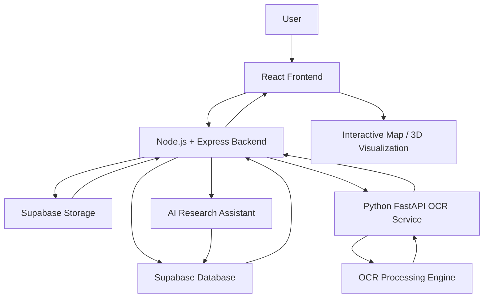

# 🏛️ Hackculters — Digital Heritage Preservation & Exploration Platform

> **HackCult ’26 | Culture & Digital Heritage Track (HC26-CULT01)**

Hackculters is a digital heritage platform designed to preserve, explore, and make historical monuments and archival knowledge more accessible through modern web technologies, geospatial visualization, AI-powered document processing, and immersive 3D experiences.

Our goal is to bridge the gap between cultural heritage and technology by bringing historical sites, archival documents, and heritage information together in one interactive platform.

---

## 📌 Problem Statement

Historical monuments and cultural archives contain valuable information about our history, architecture, traditions, and civilizations. However, much of this information is scattered across different sources, difficult to access, or available in formats that are not easily searchable.

Traditional heritage documentation also faces challenges such as:

- Limited digital accessibility to historical records.
- Historical documents stored as scanned images or PDFs.
- Difficulty extracting and understanding information from archival documents.
- Lack of interactive geographical exploration of heritage locations.
- Limited immersive digital experiences for exploring historical monuments.

Hackculters addresses these challenges through an integrated digital heritage platform.

---

## 💡 Our Solution

Hackculters combines web development, geospatial technologies, artificial intelligence, OCR, and 3D visualization to create a centralized heritage exploration experience.

The platform focuses on three major innovation areas:

1. **Interactive Heritage Mapping:** Explore heritage sites through an interactive map with geographical information and nearby discoveries.
2. **AI-Powered Archival Digitization:** Extract text from historical documents and make archival information easier to process and understand.
3. **Immersive Heritage Experiences:** Use 3D technologies to support more engaging digital representations of historical sites.

---

## ✨ Key Features

### 1. Interactive Heritage Map

- Explore heritage monuments through an interactive geographical map.
- View monument locations using geographical coordinates.
- Select a monument to view its essential information.
- Discover nearby heritage sites.
- Calculate distances between heritage locations.
- Filter and explore sites across different locations.
- View monument images and architectural information.

### 2. AI-Powered Archival OCR

The OCR service helps digitize historical documents by extracting text from uploaded images and scanned documents.

Supported processing formats are intended to include:

- JPG / JPEG
- PNG
- PDF

The OCR microservice uses Python and FastAPI, with OCR engines such as EasyOCR and other configured text-recognition tools.

### 3. AI Research Assistant

The backend provides AI-assisted document summarization and monument-related question-answering endpoints.

- Generate summaries from documents.
- Ask questions related to heritage monuments.
- Support research and discovery using digitized heritage information.

### 4. 3D Heritage Visualization

Three.js is included in the frontend technology stack to support immersive 3D heritage experiences and visualization.

### 5. Digital Heritage Archive

Supabase provides the database and storage foundation for heritage information, documents, and associated media.

---

## 🏗️ System Architecture

The platform follows a modular architecture consisting of a React frontend, Node.js backend, Supabase database, and a separate Python OCR microservice.

### Architecture Diagram



### Architecture Components

| Component | Technology | Responsibility |
|---|---|---|
| Frontend | React.js | User interface and application experience |
| Build Tool | Vite | Frontend development and bundling |
| 3D Visualization | Three.js | 3D heritage visualization |
| Mapping | Mapbox GL JS | Interactive geographical mapping |
| Backend | Node.js | Server-side application logic |
| API Framework | Express.js | REST API development and routing |
| Database | Supabase | Structured heritage data |
| Storage | Supabase Storage | Images, documents, and media files |
| OCR Microservice | Python + FastAPI | Document and image text extraction |
| OCR Engines | Configured OCR engines | Text recognition |
| AI Integration | Backend AI services | Document summarization and question answering |

---

## 🔄 Application Workflow

1. The user interacts with the React frontend.
2. The frontend communicates with the Node.js and Express backend through REST APIs.
3. The backend retrieves heritage information from Supabase.
4. Images and documents are stored and retrieved through Supabase Storage.
5. When OCR processing is required, the backend communicates with the Python FastAPI service.
6. The OCR service processes the submitted document and returns extracted text.
7. AI-related backend endpoints support document summarization and monument-related queries.
8. The frontend displays the resulting information to the user.

---

## 🛠️ Technology Stack

### Frontend
- React.js
- Vite
- JavaScript
- Three.js
- Mapbox GL JS
- CSS / Tailwind CSS (where configured)

### Backend
- Node.js
- Express.js
- REST APIs
- JavaScript (ES Modules)

### Database and Storage
- Supabase
- PostgreSQL
- Supabase Storage

### OCR and AI
- Python
- FastAPI
- OCR processing engines
- AI-powered summarization and question-answering services

### Development Tools
- Git and GitHub
- Visual Studio Code
- Postman
- npm

---

## 📂 Project Structure

```text
Hackculters/
│
├── Backend/
│   ├── src/
│   │   ├── config/
│   │   ├── controllers/
│   │   ├── middlewares/
│   │   ├── routes/
│   │   ├── services/
│   │   ├── utils/
│   │   └── workers/
│   │
│   ├── .env
│   ├── package.json
│   └── server.js
│
├── Frontend/
│   ├── src/
│   │   ├── components/
│   │   ├── pages/
│   │   ├── services/
│   │   └── ...
│   │
│   ├── .env
│   └── package.json
│
├── ocr-service/
│   ├── main.py
│   ├── requirements.txt
│   └── ...
│
├── .gitignore
└── README.md
```

*The structure above represents the major project modules. Individual filenames and folders may differ as the project evolves.*

---

## ⚙️ Installation and Setup

### Prerequisites

Install the following before running the project:

- Node.js and npm
- Python 3.10 or a compatible version required by the OCR dependencies
- Git
- A Supabase account and project
- A Mapbox account and public access token

### 1. Clone the Repository

```bash
git clone https://github.com/Nehayadav42/Hackculters.git

cd Hackculters
```

### 2. Switch to the Development Branch

The complete project is maintained on the `dev` branch.

```bash
git checkout dev
git pull origin dev
```

### 3. Setup the Backend

```bash
cd Backend
npm install
```

Create a `.env` file inside the Backend directory.

Configure the environment variables using the actual names expected by your backend code:

```env
PORT=5000
NODE_ENV=development

SUPABASE_URL=your_supabase_project_url
SUPABASE_ANON_KEY=your_supabase_anon_key

FRONTEND_ORIGINS=http://localhost:5173

GEMINI_API_KEY=your_gemini_api_key
PYTHON_OCR_URL=http://localhost:8000/process-document

CLOUDINARY_CLOUD_NAME=your_cloudinary_cloud_name
CLOUDINARY_API_KEY=your_cloudinary_api_key
CLOUDINARY_API_SECRET=your_cloudinary_api_secret
```

Start the backend:

```bash
npm run dev
```

Backend URL:

```text
http://localhost:5000
```

### 4. Setup the Frontend

Open a new terminal:

```bash
cd Frontend
npm install
```

Create a `.env` file inside the Frontend directory:

```env
VITE_SUPABASE_URL=your_supabase_project_url
VITE_SUPABASE_ANON_KEY=your_supabase_anon_key

VITE_MAPBOX_ACCESS_TOKEN=your_mapbox_public_access_token
VITE_CESIUM_ION_TOKEN=your_cesium_ion_token
```

Start the frontend:

```bash
npm run dev
```

Frontend URL:

```text
http://localhost:5173
```

### 5. Setup the OCR Microservice

Open another terminal:

```bash
cd ocr-service
```

Create and activate a Python virtual environment.

**Windows PowerShell:**

```powershell
python -m venv venv
.\venv\Scripts\Activate.ps1
```

Install dependencies:

```bash
pip install -r requirements.txt
```

Start the FastAPI service using the actual application module:

```bash
uvicorn app:app --host 0.0.0.0 --port 8000 --reload
```

OCR service URL:

```text
http://localhost:8000
```

---

## 🔌 API Documentation

The backend exposes REST APIs under:

```text
http://localhost:5000/api/v1
```

### Heritage / Monument APIs

| Method | Endpoint | Purpose |
|---|---|---|
| GET | `/api/v1/monuments/map-data` | Retrieve geographical heritage site data |

### AI Research Assistant APIs

| Method | Endpoint | Purpose |
|---|---|---|
| POST | `/api/v1/ai/summarize` | Generate a summary using a document ID |
| POST | `/api/v1/ai/chat` | Ask a question using a monument ID and question |

**Example request — Document Summarization**

```json
{
  "documentId": "YOUR_DOCUMENT_ID"
}
```

**Example request — AI Chat**

```json
{
  "monumentId": "YOUR_MONUMENT_ID",
  "question": "Tell me about the historical significance of this monument."
}
```

### OCR Microservice APIs

| Method | Endpoint | Purpose |
|---|---|---|
| GET | `/health` | Check OCR service health |
| POST | `/process-image` | Submit an image for OCR processing |

*Refer to the backend routes and OCR service implementation for the exact request formats and response schemas.*

---

## 🗄️ Database Design

The project uses Supabase, powered by PostgreSQL, for structured data management.

Key database resources include:

| Resource | Purpose |
|---|---|
| `heritage_sites` | Stores monument and heritage site information |
| `media` | Stores references to associated monument media |
| `documents` | Supports archival document information |
| `heritage-archives` | Supabase Storage bucket for heritage media and archival files |

The heritage site information includes fields such as:

- Site name
- City and state
- Latitude and longitude
- Description
- Architectural period
- Architectural style
- UNESCO heritage status

Media records are associated with heritage sites, allowing the application to retrieve the appropriate monument images.

---

## 🔐 Environment Variables and Security

For security reasons:

- Never commit `.env` files.
- Never expose Supabase service-role keys in frontend code.
- Use the Supabase anon/publishable key in the frontend with appropriate Row Level Security policies.
- Keep AI provider credentials on the backend.
- Use a public Mapbox token only in the frontend.
- Configure production environment variables separately.

Add the following to `.gitignore`:

```gitignore
node_modules/
.env
.env.*
!.env.example

venv/
__pycache__/
*.pyc

dist/
build/
```

Provide sanitized `.env.example` files so other developers can understand which configuration values are required.

---

## 🚀 Running the Complete Application

Run the three services in separate terminals:

| Service | Command | Local Port |
|---|---|---|
| Backend | `npm run dev` | 5000 |
| Frontend | `npm run dev` | 5173 |
| OCR Service | `uvicorn app:app --host 0.0.0.0 --port 8000 --reload` | 8000 |

Open the frontend:

```text
http://localhost:5173
```

---

## 🔮 Future Enhancements

The platform can be extended with:

- More detailed 3D digital twins of heritage monuments.
- Improved OCR accuracy for historical and multilingual documents.
- Multilingual archival translation.
- Advanced AI-powered heritage research.
- Interactive heritage travel routes and recommendations.
- Richer immersive experiences for digital cultural preservation.

---

## 👥 Team Hackculters

| Team Member | Role | Responsibilities |
|---|---|---|
| **Neha Yadav** | Backend Developer & OCR Workflow | Backend development, API integration, and OCR workflow implementation |
| **Meer Humayu** | Frontend Developer | Frontend development and user interface implementation |
| **Rounak Jain** | Database Developer | Database design, management, and integration |

**Team:** Hackculters  
**Hackathon:** HackCult ’26  
**Track:** HC26-CULT01 — Culture & Digital Heritage
---

## 📌 Repository and Submission

**GitHub Repository:** https://github.com/Nehayadav42/Hackculters

**Primary Development Branch:** `dev`

This repository contains the project source code and its development history. The `dev` branch is the primary branch for the complete hackathon implementation.

---

## ❤️ Acknowledgement

Built as part of **HackCult ’26**, with the vision of using modern technology to preserve, digitize, and make cultural heritage more accessible for future generations.

**Technology meets history. Preserving the past, exploring the future.**
